# Roboporter-V4

[](https://docs.ros.org/en/lyrical/index.html)
[]()
[](LICENSE)

Welcome to the central software repository for the **Roboporter Project (2026/2027)**. This project focuses on building a modular, reliable, and safe Autonomous Mobile Robot (AMR) designed for indoor payload transport within the Mappin Building.

**Phase 1** focuses strictly on establishing the core ROS 2 software infrastructure, manual teleoperation via an 8BitDo Ultimate Gamepad, command arbitration, safety watchdogs, sensor drivers, Foxglove Studio telemetry streaming, and establishing the groundwork for a Gazebo simulation digital twin in preparation for Phase 2 (full autonomy via Nav2 and SLAM Toolbox).

---

## Table of Contents
1. [System Architecture](#system-architecture)
   - [ROS 2 Software Component & Topic Mapping](#ros-2-software-component--topic-mapping)
   - [Hardware Component to ROS 2 Software Mapping](#hardware-component-to-ros-2-software-mapping)
   - [Hardware-Bounded ROS 2 Computation Graph](#1-hardware-bounded-ros-2-computation-graph)
   - [Layered Software Abstraction Diagram](#2-layered-software-abstraction-diagram)
2. [Repository Directory Structure](#repository-directory-structure)
3. [Safety & Failsafe Logic](#safety--failsafe-logic)
4. [Getting Started & Installation](#getting-started--installation)
   - [Prerequisites](#prerequisites)
   - [Operator Base Station Setup](#operator-base-station-setup)
   - [Onboard Raspberry Pi 4B Setup](#onboard-raspberry-pi-4b-setup)
5. [Building & Running the System](#building--running-the-system)
6. [Gazebo Digital Twin & Phase 2 Groundwork](#gazebo-digital-twin--phase-2-groundwork)
7. [License](#license)

---

## System Architecture

### ROS 2 Software Component & Topic Mapping

Communication within the Roboporter framework is divided across continuous high-frequency data streams (**Topics**) and deterministic two-way state configuration transactions (**Services**).

- **Topics (Publish/Subscribe):** Designed for continuous, asynchronous streams (telemetry, velocity loops, sensor feeds).
- **Services (Request/Response):** Designed for quick, two-way state changes or resets.
- **Official Driver Nodes:** `joy_node`, `rplidar_node`, `foxglove_bridge`.
- **Custom Project Nodes:** `watchdog_node`, `cmd_vel_mux`, `arduino_bridge_node`, `ultrasonic_driver_node`.

| **Subsystem / Layer**                  | **ROS 2 Node Name**                 | **Subscribed Topics / Inputs / Service Requests**  | **Communication Type**           | **Published Topics / Outputs / Service Responses**                  | **Message Type / Protocol**                     |
| -------------------------------------- | ----------------------------------- | -------------------------------------------------- | -------------------------------- | ------------------------------------------------------------------- | ----------------------------------------------- |
| **Operator PC (Remote Station)**       | `joy_node`                          | Hardware USB / 2.4GHz RF Gamepad                   | Topic (Publisher)                | `/joy`                                                              | `sensor_msgs/msg/Joy`                           |
|                                        | `teleop_twist_joy_node`             | `/joy`                                             | Topic (Subscriber / Publisher)   | `/teleop_cmd_vel`                                                   | `geometry_msgs/msg/Twist`                       |
|                                        | `Foxglove Studio` _(Diagnostic UI)_ | WebSocket Stream (`ws://<rpi_ip>:8765`)            | Telemetry Client                 | Remote monitoring display & dashboard                               | WebSocket / TCP (Wi-Fi)                         |
| **RPi 4B: Safety & Arbitration Layer** | `watchdog_node`                     | Comms Heartbeat, `/battery_status`                 | Topic (Subscriber / Publisher)   | `/failsafe_cmd_vel`, `/sys_health`                                  | `std_msgs/msg/Bool`, `geometry_msgs/msg/Twist`  |
|                                        | `watchdog_node`                     | `/reset_failsafe` _(Request)_                      | Service (Server)                 | Clear active software halt & reset safety state _(Response)_        | `std_srvs/srv/Trigger`                          |
|                                        | `cmd_vel_mux` _(Multiplexer)_       | `/teleop_cmd_vel`, `/failsafe_cmd_vel`             | Topic (Subscriber / Publisher)   | `/cmd_vel`                                                          | `geometry_msgs/msg/Twist`                       |
|                                        | `cmd_vel_mux` _(Multiplexer)_       | `/set_operation_mode` _(Request)_                  | Service (Server)                 | Toggle channel (Manual vs Failsafe override) _(Response)_           | `std_srvs/srv/SetBool`                          |
| **RPi 4B: Sensor Driver Layer**        | `rplidar_node`                      | Hardware USB UART (`/dev/ttyUSB0`)                 | Topic (Publisher)                | `/scan`                                                             | `sensor_msgs/msg/LaserScan`                     |
|                                        | `rplidar_node`                      | `/toggle_scan` _(Request)_                         | Service (Server)                 | Enable / disable LiDAR motor power _(Response)_                     | `std_srvs/srv/SetBool`                          |
|                                        | `ultrasonic_driver_node`            | GPIO / USB Serial (`/dev/ttyACM0`)                 | Topic (Publisher)                | `/ultrasonic/ranges`                                                | `sensor_msgs/msg/Range`                         |
| **RPi 4B: Microcontroller Bridge**     | `arduino_bridge_node`               | `/cmd_vel` (from Mux), USB Serial (`/dev/ttyACM1`) | Topic (Subscriber / Publisher)   | `/odom`, `/battery_status`                                          | `nav_msgs/msg/Odometry`, `std_msgs/msg/Float32` |
|                                        | `arduino_bridge_node`               | `/reset_odometry` _(Request)_                      | Service (Server)                 | Reset stored encoder counts & zero $(x,y,\theta)$ pose _(Response)_ | `std_srvs/srv/Trigger`                          |
|                                        | `arduino_bridge_node`               | `/calibrate_encoders` _(Request)_                  | Service (Server)                 | Trigger wheel motor encoder calibration _(Response)_                | `std_srvs/srv/SetBool`                          |
| **RPi 4B: Telemetry Gateway Layer**    | `foxglove_bridge`                   | `/scan`, `/odom`, `/tf`, `/sys_health`             | Topic (Subscriber) / WS Server   | Encapsulated WebSocket Stream                                       | `ros-humble-foxglove-bridge` (TCP Port 8765)    |
| **Arduino Mega 2560 R3 Firmware**      | `embedded_control_loop`             | Serial commands (`cmd_vel`), HEDS-5500 Encoders    | Hardware Control / Serial Bridge | Dual PWM outputs to Mtronics ESCs                                   | 5V PWM signal / `analogWrite`                   |

---

### Hardware Component to ROS 2 Software Mapping

| **Physical Hardware Component**             | **Subsystem Role**                                             | **Target Execution Platform** | **ROS 2 Node Name**                                            | **Topic / Service Interface Name**                                                                                            | **Message / Service Type / Protocol**                                                                                                                           |
| ------------------------------------------- | -------------------------------------------------------------- | ----------------------------- | -------------------------------------------------------------- | ----------------------------------------------------------------------------------------------------------------------------- | --------------------------------------------------------------------------------------------------------------------------------------------------------------- |
| **8BitDo Ultimate / Gamepad**               | Manual Operator Input                                          | Operator Base Station PC      | `joy_node`                                                     | `/joy`                                                                                                                        | `sensor_msgs/msg/Joy`<br>(USB HID / 2.4GHz RF)                                                                                                                  |
| **Operator Laptop / Base Station**          | Teleop Command Processing & UI Monitoring                      | Operator Base Station PC      | `teleop_twist_joy_node`<br><br>`Foxglove Studio`               | `/teleop_cmd_vel`<br><br>`ws://<rpi_ip>:8765`                                                                                 | `geometry_msgs/msg/Twist`<br>WebSocket / TCP (Wi-Fi)                                                                                                            |
| **Raspberry Pi 4B**                         | Onboard High-Level Host, Safety Controller & Telemetry Gateway | Raspberry Pi 4B               | `watchdog_node`<br><br>`cmd_vel_mux`<br><br>`foxglove_bridge`  | `/failsafe_cmd_vel`, `/reset_failsafe`<br><br>`/cmd_vel`, `/set_operation_mode`<br><br>`/scan`, `/odom`, `/tf`, `/sys_health` | `geometry_msgs/msg/Twist`, `std_srvs/srv/Trigger`<br><br>`geometry_msgs/msg/Twist`, `std_srvs/srv/SetBool`<br><br>`ros-lyrical-foxglove-bridge` (TCP Port 8765) |
| **Slamtec RPLiDAR A1M8**                    | 2D Laser Distance & Obstacle Scanning                          | Raspberry Pi 4B               | `rplidar_node`                                                 | `/scan`<br><br>`/toggle_scan`                                                                                                 | `sensor_msgs/msg/LaserScan`<br><br>(USB UART `/dev/ttyUSB0`)<br><br>`std_srvs/srv/SetBool`                                                                      |
| **HC-SR04 Ultrasonic Sensors**              | Short-Range Obstacle Detection                                 | Raspberry Pi 4B               | `ultrasonic_driver_node`                                       | `/ultrasonic/ranges`                                                                                                          | `sensor_msgs/msg/Range`<br><br>(GPIO / USB Serial `/dev/ttyACM0`)                                                                                               |
| **Arduino Mega 2560 R3**                    | Low-Level Motor Control & Encoder Gateway                      | Arduino Mega 2560 R3          | `arduino_bridge_node`<br><br>  <br><br>`embedded_control_loop` | `/odom`, `/battery_status`, `/reset_odometry`<br><br>Direct Hardware Pins                                                     | `nav_msgs/msg/Odometry`, `std_srvs/srv/Trigger`<br><br>  <br>(USB Serial `/dev/ttyACM1`)<br><br>Dual PWM Outputs & Interrupt Service Routines (ISRs)            |
| **HEDS-5500 Optical Encoders**              | Wheel Speed & Pulse Feedback                                   | Arduino Mega 2560 R3          | N/A (Read by firmware)                                         | Hardware Quadrature Channels A/B                                                                                              | 5V TTL Quadrature Pulse Ticks                                                                                                                                   |
| **Mtronics Viper Marine 15A ESCs & Motors** | Drive Actuation & Wheel Motion                                 | Roboporter Drive Chassis      | N/A (Driven by MCU signals)                                    | Motor Signal Wires (Left/Right)                                                                                               | 5V PWM Signals / Servo Control Pulses                                                                                                                           |

---

### 1. Hardware-Bounded ROS 2 Computation Graph



---

### 2. Layered Software Abstraction Diagram



---

## Repository Directory Structure

```text
roboporter_ws/
├── .github/
│   ├── ISSUE_TEMPLATE/
│   │   ├── bug_report.md
│   │   └── feature_request.md
│   └── workflows/
│       └── ros_ci.yml                  # GitHub Actions CI for Colcon build & linting
├── config/
│   ├── cmd_vel_mux.yaml                # Priority rules for command multiplexing
│   ├── foxglove_dashboard.json         # Preset Foxglove Studio diagnostic layout
│   └── teleop_config.yaml              # Gamepad button/axis mapping and deadzones
├── docs/
│   ├── diagrams/
│   │   ├── computation_graph.md
│   │   └── layered_software_abstraction.md
│   ├── hardware_mapping.md             # Hardware pinout and UART mapping
│   └── setup_tasks.md                  # Task setup documentation
├── firmware/
│   └── arduino_mega_control/
│       ├── arduino_mega_control.ino    # MCU main loop & serial listener
│       ├── encoder_driver.h            # Quadrature encoder ISR handlers (HEDS-5500)
│       └── esc_driver.h                # Dual PWM output driver for Mtronics ESCs
└── src/
    ├── roboporter_bringup/             # Top-level launch files
    │   ├── launch/
    │   │   ├── operator_pc.launch.py   # Launches joy_node & teleop_twist_joy
    │   │   └── robot_onboard.launch.py # Launches drivers, watchdog, mux & bridge
    │   ├── package.xml
    │   └── CMakeLists.txt
    ├── roboporter_description/         # URDF/Xacro digital twin model
    │   ├── urdf/
    │   │   ├── roboporter.urdf.xacro
    │   │   └── roboporter_gazebo.xacro
    │   ├── package.xml
    │   └── CMakeLists.txt
    ├── roboporter_drivers/             # Custom hardware interface wrapper nodes
    │   ├── roboporter_drivers/
    │   │   ├── arduino_bridge_node.py
    │   │   └── ultrasonic_driver_node.py
    │   ├── package.xml
    │   └── setup.py
    ├── roboporter_gazebo/              # Gazebo simulation worlds and setups
    │   ├── worlds/
    │   │   └── mappin_floor.world      # Digital twin of Mappin Building floor
    │   ├── launch/
    │   │   └── gazebo_sim.launch.py
    │   ├── package.xml
    │   └── CMakeLists.txt
    ├── roboporter_safety/              # Watchdog & arbitration logic
    │   ├── roboporter_safety/
    │   │   └── watchdog_node.py
    │   ├── package.xml
    │   └── setup.py
    └── roboporter_teleop/              # Teleoperation wrappers & launch configs
        ├── package.xml
        └── CMakeLists.txt
```

---

## Safety & Failsafe Logic

Safety is enforced via a two-tier safety system combining a physical hardware cut-off with automatic software safety watchdogs.

### 1. Hardware Emergency Stop
A physical emergency stop button wired into the 12V supply path hard-cuts power directly to the Mtronics ESC motor controllers, bringing the chassis to an immediate physical halt while retaining power to the Raspberry Pi to preserve log data.

### 2. Software Watchdog (`watchdog_node`)
The `watchdog_node` runs as a high-priority supervisor process on the Raspberry Pi:
- **Loss of Communication:** Monitors the arrival frequency of incoming teleoperation heartbeats (`/teleop_cmd_vel`). If latency exceeds **250 ms** or connection drops entirely, the watchdog overrides movement by continuously publishing zero-velocity vectors to `/failsafe_cmd_vel`.
- **Sensor Failure:** Monitors operational heartbeat streams from `rplidar_node` and `ultrasonic_driver_node`.
- **Low Battery Warning:** Monitors `/battery_status`. If system voltage drops below threshold, software halts motion and flags an error to `/sys_health`.
- **Manual Failsafe Reset:** Active failsafe states can be cleared by calling the `/reset_failsafe` service (`std_srvs/srv/Trigger`).

---

## Getting Started & Installation

### Prerequisites
- **ROS 2 Humble Hawksbill** installed on Ubuntu 22.04 LTS (Desktop version for Operator PC, Server/Minimal for RPi 4B).
- `colcon` build system and standard ROS 2 dependencies (`geometry_msgs`, `sensor_msgs`, `nav_msgs`, `std_srvs`).
- **Foxglove Studio** installed on the Operator Base Station PC.

### Operator Base Station Setup
1. Clone the repository into your ROS 2 workspace:
   ```bash
   mkdir -p ~/roboporter_ws/src
   cd ~/roboporter_ws/src
   git clone https://github.com/your-org/roboporter_ros2.git .
   ```
2. Install dependencies:
   ```bash
   cd ~/roboporter_ws
   rosdep update
   rosdep install --from-paths src --ignore-src -r -y
   ```
3. Connect the **8BitDo Ultimate Gamepad** via USB or 2.4GHz dongle.

### Onboard Raspberry Pi 4B Setup
1. Clone the repository into `~/roboporter_ws/src` on the Pi.
2. Grant permissions for USB serial devices:
   ```bash
   sudo usermod -a -G dialout $USER
   sudo udevadm control --reload-rules && sudo udevadm trigger
   ```
3. Flash the firmware located in `firmware/arduino_mega_control/` to the Arduino Mega 2560 R3 using Arduino IDE or PlatformIO CLI.

---

## Building & Running the System

### 1. Build the Workspace
On both Operator PC and Raspberry Pi:
```bash
cd ~/roboporter_ws
colcon build --symlink-install
source install/setup.bash
```

### 2. Launch Operator Station (Operator PC)
Plug in the 8BitDo gamepad and launch the teleop pipeline:
```bash
ros2 launch roboporter_bringup operator_pc.launch.py
```

### 3. Launch Onboard Robot Core (Raspberry Pi 4B)
SSH into the Raspberry Pi and execute the onboard bringup:
```bash
ros2 launch roboporter_bringup robot_onboard.launch.py
```

### 4. Open Diagnostic Interface (Foxglove Studio)
1. Launch Foxglove Studio on the Operator PC.
2. Select **Open Connection** -> **Foxglove WebSocket**.
3. Enter `ws://<raspberry_pi_ip>:8765`.
4. Load the dashboard template from `config/foxglove_dashboard.json`.

---

## Gazebo Digital Twin & Phase 2 Groundwork

To prepare for Phase 2 (full point-to-point autonomy using `Nav2`, `BehaviorTree.CPP`, and `SLAM Toolbox`), a simulation digital twin of both the Roboporter chassis and the Mappin Building floor plan is included in `roboporter_description` and `roboporter_gazebo`.

To launch the virtual robot in the Gazebo simulation environment:
```bash
ros2 launch roboporter_gazebo gazebo_sim.launch.py
```
This launches the URDF differential-drive model, simulates ray-casted 2D RPLiDAR output, and exposes identical ROS 2 topic/service interfaces as the physical hardware, enabling safe software testing without operational risk or chassis wear.

---

## License
Distributed under the MIT License. See `LICENSE` for more information.