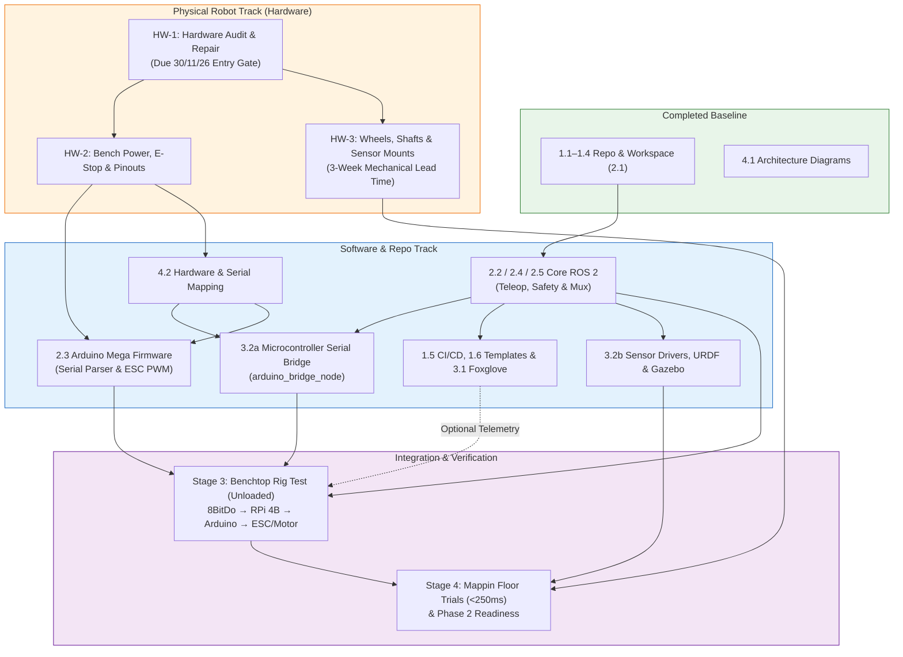

# Repository Setup Tasks: Roboporter V4 (Phase 1)

This document outlines the tasks required to initialise, structure, and configure the `Roboporter-V4` GitHub repository for **Phase 1: Remote Control, Failsafe Arbitration & Base Platform Setup**, while establishing groundwork for **Phase 2: Autonomous Navigation (Nav2, SLAM Toolbox, BehaviorTree.CPP)**.

---

## Team Role & Skill Alignment

| Team Member | Discipline & Background | Primary Repository Responsibilities |
| :--- | :--- | :--- |
| **Ivan Gao** | MEng ECE *(ROS 2 Lead)* | Core ROS 2 packages (`bringup`, `teleop`, `safety`), serial bridge (`arduino_bridge_node`), `cmd_vel_mux` arbitration, MCU firmware scaffolding, CI/CD, and PR reviews. |
| **Yuqi Guo** | MEng ECE *(Software & Simulation)* | Sensor driver wrappers (`rplidar_node`, `ultrasonic_driver_node`), URDF/Xacro modeling (`roboporter_description`), Gazebo Mappin digital twin (`roboporter_gazebo`), Foxglove JSON layout, and GitHub templates. |
| **Nurul Gasre** | MEng EEE *(Firmware & Control Signals)* | Mtronics ESC PWM bench verification, HEDS-5500 encoder signal testing, and hardware pinout/serial documentation inputs. |
| **Cenk Akan** | MEng EEE *(Power, Chassis & Diagnostics)* | Power distribution, hardware E-stop and chassis integration, Foxglove diagnostic metric requirements, and hardware/power mapping verification. |

---

## Master Task Allocation & Priority Matrix

| Category | Task ID & Name | Summary Description | Priority | Owner | Status |
| :--- | :--- | :--- | :--- | :--- | :--- |
| **1. Repo Admin & Governance** | **1.1–1.4 Repo & Branch Setup** | Initialise repo, add license, ROS 2/Arduino `.gitignore`, and branch protections on `main` and `dev`. | **Completed** | **Ivan** | Done |
| **1. Repo Admin & Governance** | **1.5 GitHub Actions CI/CD** | Automate `colcon build`, `colcon test`, and linters (`flake8`, `cpplint`, `pep257`) on pull requests (post-demo enforcement). | **Medium** | **Ivan** | Pending |
| **1. Repo Admin & Governance** | **1.6 Issue & PR Templates** | Create templates for Bug Reports, Feature Requests, and Hardware Integration Tests. | **Low** | **Yuqi** | Pending |
| **2. Core Control & Safety** | **2.1 Colcon Workspace Layout** | Establish root directory structure (`src/`, `firmware/`, `config/`, `docs/`, `Images/`). | **Completed** | **Ivan** | Done |
| **2. Core Control & Safety** | **2.2 Core ROS 2 Packages** | Scaffold `roboporter_bringup`, `roboporter_teleop`, and `roboporter_safety` (`watchdog_node`, `cmd_vel_mux`). | **Critical** | **Ivan** | Pending |
| **2. Core Control & Safety** | **2.3 MCU Firmware Scaffolding** | Set up `firmware/arduino_mega_control/` for serial command parsing, HEDS-5500 encoder ISRs, and Mtronics ESC PWM outputs. | **Critical** | **Ivan** *(repo)* / **Nurul** *(bench PWM)* | Pending |
| **2. Core Control & Safety** | **2.4 Multiplexer Rules Config** | Create `config/cmd_vel_mux.yaml` setting priorities: Failsafe (1), Teleop (2), Nav2 (3). | **Critical** | **Ivan** | Pending |
| **2. Core Control & Safety** | **2.5 Teleop Gamepad Config** | Create `config/teleop_config.yaml` with 8BitDo Ultimate button/axis mappings, deadzones, and velocity limits. | **High** | **Ivan** | Pending |
| **3. Diagnostics, Sensors & Sim** | **3.1 Foxglove Studio Layout** | Build and commit `config/foxglove_dashboard.json` for `/sys_health`, `/battery_status`, `/odom`, and `/scan`. | **Low** | **Yuqi** | Pending |
| **3. Diagnostics, Sensors & Sim** | **3.2a Microcontroller Serial Bridge** | Implement `arduino_bridge_node` in `roboporter_drivers` to translate `/cmd_vel` into USB serial packets (`/dev/ttyACM1`) and publish encoder/battery telemetry. | **Critical** | **Ivan** | Pending |
| **3. Diagnostics, Sensors & Sim** | **3.2b Sensor Drivers & Simulation** | Implement `rplidar_node` and `ultrasonic_driver_node` wrappers, `roboporter_description` (URDF/Xacro), and `roboporter_gazebo` (Mappin world). | **Low** *(Late Phase 1)* | **Yuqi** | Pending |
| **4. System Documentation** | **4.1 Architecture Diagrams** | Embed Mermaid.js sources and SVGs for Computation Graph and Layered Abstraction Diagram. | **Completed** | **Ivan** | Done |
| **4. System Documentation** | **4.2 Hardware & Topic Mapping** | Document MCU pinouts, serial device paths, and ROS 2 topic/service tables in `docs/hardware_mapping.md`. | **Medium** | **Nurul & Cenk** *(inputs)* / **Ivan** *(git commit)* | Pending |

---

## Task Breakdown

### 1. Repository Administration, Governance & CI/CD
*Tasks focused on version control hygiene, branch protection, automated testing, and team collaboration workflows.*

- [X] **1.1 Create Repository** — `[Priority: High]` | **Owner:** Ivan
  - Initialise the `Roboporter-V4` GitHub repository under the team organization/account.
- [X] **1.2 License & Metadata** — `[Priority: Low]` | **Owner:** Ivan
  - Add project description, repository topics (`ros2`, `robotics`, `raspberry-pi`, `arduino`, `teleoperation`, `gazebo`), and open-source `LICENSE`.
- [X] **1.3 Baseline `.gitignore`** — `[Priority: High]` | **Owner:** Ivan
  - Configure ignore rules for ROS 2 (`build/`, `install/`, `log/`), Python (`__pycache__/`, `*.pyc`, `.venv/`), IDE metadata (`.vscode/`), and Arduino build artifacts.
- [X] **1.4 Branch Protection Rules** — `[Priority: Completed]` | **Owner:** Ivan
  - Protect `main` (stable releases) and `dev` (integration branch), enforcing pull request (PR) reviews before merging.
- [ ] **1.5 GitHub Actions CI/CD Workflow (`.github/workflows/ros_ci.yml`)** — `[Priority: Medium]` | **Owner:** Ivan
  - Automate ROS 2 Lyrical workspace compilation (`colcon build`) on every PR into `dev` or `main`.
  - Execute automated unit tests (`colcon test`) and code linters (`ament_flake8`, `ament_cpplint`, `ament_pep257`) once the initial bench demonstration milestone is complete.
- [ ] **1.6 Issue & Pull Request Templates (`.github/`)** — `[Priority: Low]` | **Owner:** Yuqi
  - Add standardised markdown templates for **Bug Reports**, **Feature Requests**, and **Hardware Integration Test Logs**, plus a PR verification checklist.

---

### 2. Core Control, Teleoperation & Safety Architecture (Phase 1 Critical Path)
*High-priority scaffolding and configuration required to achieve manual gamepad driving and automatic watchdog failsafe overrides on the physical robot.*

- [X] **2.1 Colcon Workspace Root Layout** — `[Priority: High]` | **Owner:** Ivan
  - Establish top-level directories (`src/`, `firmware/`, `config/`, `docs/`, `Images/`).
- [ ] **2.2 Core ROS 2 Packages (`src/`)** — `[Priority: Critical]` | **Owner:** Ivan
  - `roboporter_bringup`: Launch files for Operator PC and onboard Raspberry Pi 4B (`ros_domain_id` unified).
  - `roboporter_teleop` *(Python / `ament_python`)*: 8BitDo Ultimate gamepad parsing (`joy_node`) and velocity command generation (`teleop_twist_joy`).
  - `roboporter_safety` *(Python / `ament_python`)*: `watchdog_node` (comms heartbeat, sensor health, and battery voltage monitor) and `cmd_vel_mux` priority arbitration.
- [ ] **2.3 Embedded Microcontroller Firmware (`firmware/arduino_mega_control/`)** — `[Priority: Critical]` | **Owner:** Ivan *(repo)* / Nurul *(bench PWM)*
  - Establish Arduino IDE / PlatformIO project structure for the **Arduino Mega 2560 R3**.
  - Implement serial command parsing (`/dev/ttyACM1`), microcontroller-level serial timeout failsafe (auto-neutral at 1500 µs), **HEDS-5500** quadrature encoder interrupts (ISRs), and dual 5V PWM outputs to the **Mtronics Viper Marine 15A ESCs**.
- [ ] **2.4 Command Multiplexer Configuration (`config/cmd_vel_mux.yaml`)** — `[Priority: Critical]` | **Owner:** Ivan
  - Configure strict channel priority rules and timeout thresholds:
    1. `/failsafe_cmd_vel` *(Priority 1 — Watchdog Emergency Override)*
    2. `/teleop_cmd_vel` *(Priority 2 — Manual Operator Control)*
    3. `/nav_cmd_vel` *(Priority 3 — Reserved for Phase 2 Nav2 Autonomy)*
- [ ] **2.5 Gamepad Teleoperation Configuration (`config/teleop_config.yaml`)** — `[Priority: High]` | **Owner:** Ivan
  - Define button index mappings (including deadman enable switch), analog stick deadzones, and safe maximum linear/angular velocity scaling for the **8BitDo Ultimate Gamepad**.

---

### 3. Telemetry Diagnostics, Sensor Drivers & Simulation Groundwork
*Critical microcontroller serial bridging separated from lower-priority telemetry dashboards, environmental sensors, and Phase 2 Gazebo simulation setup.*

- [ ] **3.1 Foxglove Studio Dashboard Layout (`config/foxglove_dashboard.json`)** — `[Priority: Low]` | **Owner:** Yuqi
  - Configure and export a pre-built Foxglove Studio layout connecting to `foxglove_bridge` (`ws://<rpi_ip>:8765`) with diagnostic panels for `/sys_health`, `/battery_status`, `/odom`, `/ultrasonic/ranges`, and `/scan`.
- [ ] **3.2a Microcontroller Serial Bridge (`src/roboporter_drivers`)** — `[Priority: Critical]` | **Owner:** Ivan
  - `arduino_bridge_node` *(Python / C++)*: Subscribe to `/cmd_vel`, convert linear/angular velocities into differential wheel commands, transmit structured serial packets over `/dev/ttyACM1` at 20–50 Hz, and publish `/odom` and `/battery_status` telemetry.
- [ ] **3.2b Sensor Drivers & Simulation Packages (`src/`)** — `[Priority: Low — Late Phase 1]` | **Owner:** Yuqi
  - `roboporter_drivers` *(Sensor Wrappers)*: **HC-SR04** ultrasonic array driver (`ultrasonic_driver_node`) and **Slamtec RPLiDAR A1M8** launch wrappers (`rplidar_node`).
  - `roboporter_description`: URDF/Xacro kinematic model, wheel/sensor TF frames (`base_link`, `laser_frame`), and collision geometries.
  - `roboporter_gazebo`: 3D simulation world files (Mappin Building corridor test environment) and differential-drive Gazebo plugins for Phase 2 Nav2 benchmarking.

---

### 4. System Architecture & Hardware Documentation
*Reference documentation mapping physical wiring, serial interfaces, and software communication graphs.*

- [X] **4.1 Software Architecture & Computation Diagrams (`docs/diagrams/`, `Images/`)** — `[Priority: Completed]` | **Owner:** Ivan
  - Commit Mermaid.js source files and rendered SVGs for the **Hardware-Bounded ROS 2 Computation Graph** and **Layered Software Abstraction Diagram**.
- [ ] **4.2 Hardware Pinout & ROS Interface Mapping (`docs/hardware_mapping.md`)** — `[Priority: Medium]` | **Owner:** Nurul & Cenk *(inputs)* / Ivan *(git commit)*
  - Consolidate physical wiring assignments (Arduino PWM/ISR pins, ultrasonic GPIO pins, battery voltage divider pins), Linux udev/serial device paths (`/dev/ttyUSB0`, `/dev/ttyACM0`, `/dev/ttyACM1`), and ROS 2 topic/service interface tables.

---

## Workflow & Dependencies

#### Stage 1: Foundation & Hardware Audit
* **Software Foundation :** Repo governance (`1.1–1.4`), workspace structure (`2.1`), and architecture diagrams (`4.1`) are complete, unblocking all coding tasks.
* **Physical Audit & Bench Hardware Prep (Gate):** Verify existing batteries, 12V-to-5V buck converters, Mtronics ESCs, HEDS-5500 encoders, Raspberry Pi 4B, and Arduino Mega. Isolate one ESC + motor + power/E-stop rig for immediate bench integration while mechanical wheels and shafts undergo fabrication.

#### Stage 2: Interface Definition & Core Control Scaffolding
* **Hardware Wiring & Pinouts $\rightarrow$ Docs (`4.2`), Firmware (`2.3`) & Serial Bridge (`3.2a`):** Finalising Arduino PWM/ISR pinouts, serial port mapping (`/dev/ttyACM1`), and the inline hardware E-stop unblocks `docs/hardware_mapping.md` (`4.2`), Arduino firmware (`2.3`), and `arduino_bridge_node` (`3.2a`).
* **Core ROS 2 Teleop & Safety (`2.2`, `2.4`, `2.5`):** `roboporter_bringup`, `roboporter_teleop`, and `roboporter_safety` establish the `/joy` $\rightarrow$ `/teleop_cmd_vel` $\rightarrow$ `cmd_vel_mux` $\rightarrow$ `/cmd_vel` pipeline required by `3.2a`.
* **Parallel Non-Blocking Tasks (`1.5`, `1.6`, `3.1`, `3.2b`):** Repo templates (`1.6`), Foxglove layout (`3.1`), URDF/Gazebo simulation (`3.2b`), and post-demo CI/CD (`1.5`) progress in parallel without blocking Stage 3 motor actuation.

#### Stage 3: Unloaded Benchtop Rig Integration & Safety Verification
* **Convergence Point:** Requires **12V Power & Hardware E-Stop**, **Arduino Firmware (`2.3`)**, **Core ROS 2 Teleop/Safety (`2.2`, `2.4`, `2.5`)**, and **Microcontroller Serial Bridge (`3.2a`)**.
* **Verification:** Flash the Arduino Mega, verify end-to-end 8BitDo $\rightarrow$ Operator PC $\rightarrow$ RPi 4B $\rightarrow$ Arduino $\rightarrow$ Mtronics ESC variable motor speed control on an unloaded bench rig, and validate software watchdog timeouts (<250 ms) plus physical E-stop cutoffs.

#### Stage 4: Live Floor Trials & Phase 2 Prep
* **Physical Floor Testing:** Depends on passing Stage 3 bench safety checks and fitting the manufactured wheels, shafts, and chassis mounts. Conduct live remote driving tests in Mappin Building (<250 ms latency target).
* **Sensors & Digital Twin (`3.2b`):** Mounting/wiring the RPLiDAR A1M8 and HC-SR04 sensors unlocks full `roboporter_drivers` integration alongside `roboporter_description` (URDF) and `roboporter_gazebo` (Mappin world) for Phase 2 SLAM/Nav2.

### Dependency & Workflow Diagram

